# Clarity Theme for Enlightenment

**Clarity** es un tema personalizado para el entorno de escritorio **Enlightenment (E)**, diseñado con un enfoque limpio, moderno y funcional. Cuenta con soporte nativo para dos variantes visuales: **Dark** y **Light**.

---

## 🎨 Vista Previa (Preview)

A continuación se muestran los módulos y gadgets diseñados para ambas variantes visuales:

| Gadget | Dark | Light |
| :--- | :---: | :---: |
| **Batería** | 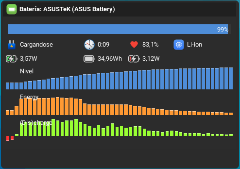 | 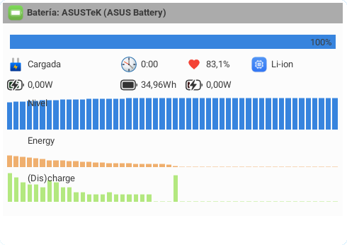 |
| **Bluetooth** | 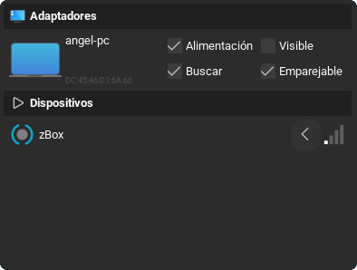 | 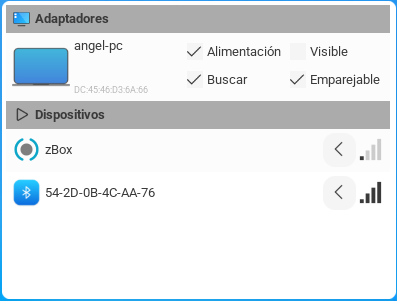 |
| **Brillo** |  |  |
| **Calendario** | 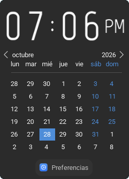 | 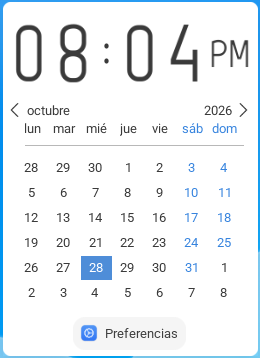 |
| **Mezclador de Audio** | 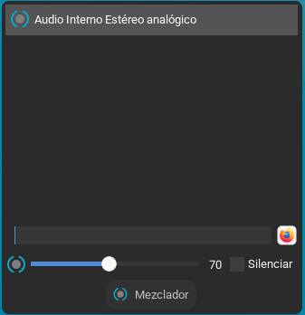 | 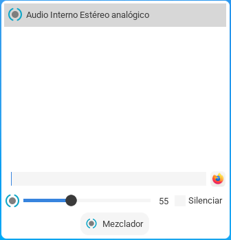 |
| **Control de Música** | 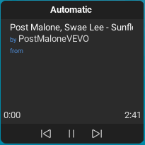 | 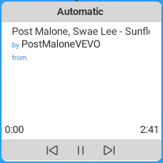 |
| **Red (Network)** | 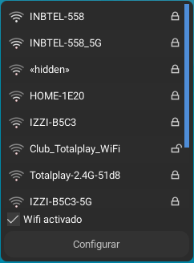 | 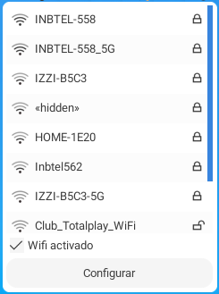 |
| **Filemanager** | 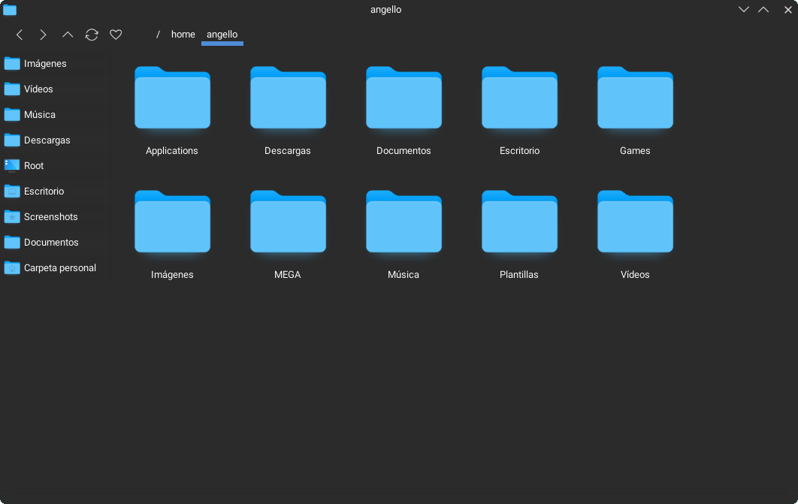 | 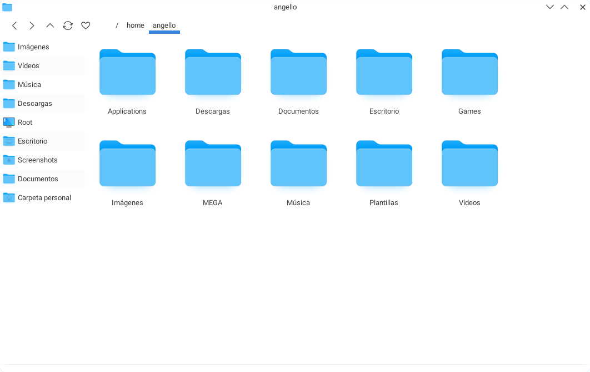 |
| **Everything Launcher** | 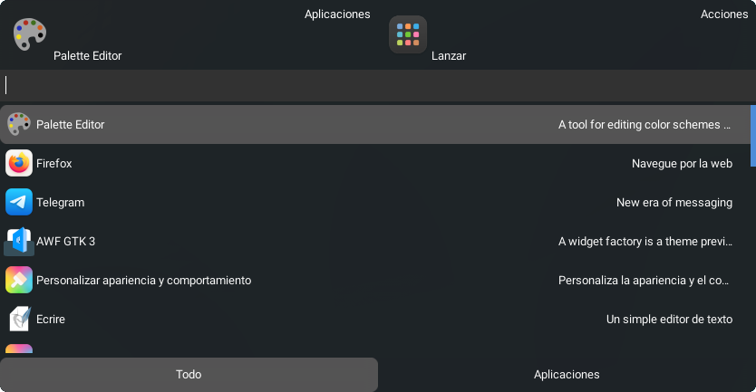 | 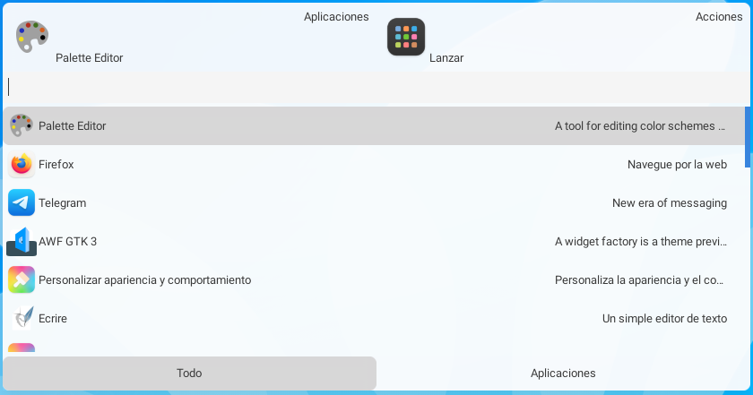 |

---

## 🛠️ Compilación e Instalación

### Requisitos previos

Asegúrate de contar con las bibliotecas básicas de desarrollo de Enlightenment (**EFL** y herramientas como `edje_cc`) instaladas en tu sistema.

### Pasos para compilar

1. Clona este repositorio en tu máquina local:
   ```bash
   git clone https://github.com/tu-usuario/clarity-theme.git
   cd clarity-theme
   ```

2. Otorga permisos de ejecución al script de compilación (si aún no los tiene):
   ```bash
   chmod +x .build
   ```

3. Ejecuta el script de compilación `.build`:
   ```bash
   ./.build
   ```

---

## 🚀 Aplicar el Tema

Una vez compilado el archivo `.edj` resultante:

1. Copia el archivo `.edj` generado a tu directorio de temas de Enlightenment:
   ```bash
   cp Clarity.edj ~/.e/e/themes/
   ```
2. Ve al menú principal de **Enlightenment** > **Configuración** > **Tema**.
3. Selecciona **Clarity** en la lista y presiona **Aplicar**.

---

## 🤝 Contribuciones

¡Las sugerencias, correcciones de errores e *issues* son más que bienvenidos! Si encuentras algún detalle visual o quieres colaborar, siéntete libre de abrir un *pull request*.

---

## 📄 Licencia

Este proyecto se distribuye bajo la licencia **MIT**.
